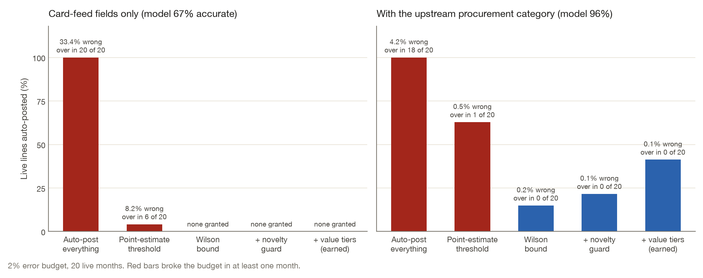

<!-- Generated from docs/README.template.md by `trustgate readme`. Edit the template, not this file. -->
# TrustGate

[](https://github.com/VijayChamakuri/trustgate/actions/workflows/ci.yml)
[](https://www.python.org/)
[](LICENSE)

Someone has to decide when a model may book a purchase-card line, or approve an expense, with no person checking.

I built a gate that allows it only when the upper bound on audited error fits a budget, tested on Stockport Council's published cards and a synthetic expense agent.

On the last 20 months it booked 41.3% of lines alone, at 0.13% error, when a staff category was available, and none from the card feed alone.



*Share of live lines booked with no review, at a 2% error budget. Red bars went over that budget in at least one month. The titles on the panels are this model's accuracy on these same live months, 66.6% on the card feed and 95.8% with the staff category, drawn rounded as 67% and 96%. The rolling yearly test is a different score. It is in [docs/METHODOLOGY.md](docs/METHODOLOGY.md).*

| What the model can see | Booked with no review | Error on those lines | Months over the 2% budget |
|---|---:|---:|---:|
| Card feed only | 0.0% | – | 0 of 20 |
| Card feed plus the staff category | 41.3% | 0.13% | 0 of 20 |

*Earned autonomy on the last 20 labelled months: Wilson upper bound, a novelty guard, and a separate threshold for larger amounts. A dash means no lines were booked, so there is no error rate.*

Booked with no review means the gate posted the general ledger (GL) account and no person checked that line. The Wilson upper bound is a cautious reading of the audited error rate: with a small sample it stays high, so the action stays with a person.

The gate books a lot of lines when the staff category is present and nothing when it is not. The usual shortcut, a threshold from the average audited error, went over the budget in 6 of 20 months. The other policies are in [docs/RESULTS.md](docs/RESULTS.md).

## How it works

### The gate

The rule is `choose_threshold` in [`autonomy.py`](src/trustgate/autonomy.py). It walks a fixed grid of score cutoffs and takes the lowest one where at least 50 audited examples sit above it and the Wilson upper bound on their error rate is inside the budget. The cutoff is refit every month from earlier audits only, so a later month can lose the right to act. A merchant the model has not seen, or a memo word absent from training in the synthetic world, goes to a person whatever the score, and larger amounts (£250 on the council file, $500 in the synthetic gate) have to earn a cutoff of their own.

```python
for tau in GRID:
    sel = conf >= tau
    n = int(sel.sum())
    if n < min_n:
        return None
    errors = int((~correct[sel]).sum())
    bound = wilson_interval(errors, n)[1] if conservative else errors / n
    if bound <= budget:
        return float(tau)
return None
```

### Coding the council lines

The label is the GL account staff booked. A reviewed seed maps each raw purpose string onto one of 21 accounts ([`stockport_purpose_map.csv`](warehouse/seeds/stockport_purpose_map.csv)). For each year from 2018 through 2022 the coder in [`realgl.py`](src/trustgate/realgl.py) trains only on earlier years. The model comparison is in [docs/METHODOLOGY.md](docs/METHODOLOGY.md).

### The policy agent

Expense decisions have no public labels, so a generator plants the receipt, who attended, the cabin, and whether the purchase was personal ([`generate.py`](src/trustgate/generate.py)). The agent sees the card descriptor, the merchant category code (MCC), the memo, and the receipt text. It resolves the merchant, fills a fixed signal record, and applies a policy that cites section ids ([`resolve.py`](src/trustgate/resolve.py), [`extract.py`](src/trustgate/extract.py), [`policy.py`](src/trustgate/policy.py)). Across 10 seeds the earned-autonomy policy kept the realized error at or under its 1% budget every time; a threshold fit to the average audited error broke that budget in 10/10.

### The warehouse

Both tracks sit in a dbt (data build tool) project on DuckDB ([`warehouse/`](warehouse)). Duplicate charges, split purchases, limit breaches, and missing receipts are defined once in SQL (Structured Query Language) and read by the agent and the marts ([`int_txn_enriched.sql`](warehouse/models/intermediate/int_txn_enriched.sql)). Scoring uses the 14,851 labelled lines from 2017–2022. The download, the checksum manifest, and the three publisher layouts are in [docs/METHODOLOGY.md](docs/METHODOLOGY.md).

## Design decisions

| Choice | Why | Cost |
|---|---|---|
| Wilson upper bound, and at least 50 audits | Zero errors in a small sample can still hide a high error rate. The same function puts the upper bound for 0 errors in 40 audits at 8.8% | The gate waits. Early months book nothing |
| Thresholds from a random audit, not from reviewer clicks | Past approvals are lenient. Thresholds learned from them broke the 1% budget in 6/10 synthetic seeds | Someone has to label the sample: 40 council lines a month, 500 in the default synthetic world |
| Novelty guard | The score was fit on traffic the model has seen | 16.4% of the live council lines are new merchants and stay with a person |
| Separate amount tiers | One threshold is dominated by small amounts | Large lines usually stay with a person when the audit is a random sample |
| Treat the card feed as the result | Staff assigned the procurement category with the label. On the rolling yearly test a lookup on that category alone is 90.8% | On that same yearly test the card-feed model is 62.4%. The chart above is the live months, a different score. The gate books nothing from the card feed |
| Local embeddings only, in the reported numbers | The run has to repeat without paying for a model call | The Claude extractor is implemented and unit-tested, and it has no benchmark numbers |

The short records behind these rows are in [docs/DESIGN_DECISIONS.md](docs/DESIGN_DECISIONS.md).

## Evaluation

- [`tests/test_autonomy.py`](tests/test_autonomy.py) — Wilson interval, small samples, and routing locks
- [`tests/test_realgl.py`](tests/test_realgl.py) — label ceiling, unseen merchants, calibration
- [`tests/test_policy.py`](tests/test_policy.py) — cited decisions; misses "Negroni" and "Delta One"
- [`tests/test_resolve_and_extract.py`](tests/test_resolve_and_extract.py) — look-alike merchants and the Claude tool schema
- [`tests/test_stockport.py`](tests/test_stockport.py) — the three publisher layouts
- [`tests/test_generate.py`](tests/test_generate.py) — deterministic generation; gold stays out of the warehouse
- [`tests/test_readme.py`](tests/test_readme.py) — this page matches the result files

`make test` runs ruff, mypy, and pytest (24 tests). Continuous integration (CI) runs the same checks ([`.github/workflows/ci.yml`](.github/workflows/ci.yml)). The warehouse build also runs the SQL tests in [`warehouse/tests/`](warehouse/tests/). The smoke job runs that build, then the default synthetic world.

The two benchmarks are the other check. On the council file, models are scored year by year and the gate is rolled forward at 2%, 5%, and 10% budgets ([`results/real/`](results/real)). On the synthetic agent, 10 seeds, a one-at-a-time sensitivity sweep with 3 seeds at each point, and a drop-one ablation ([`results/experiments.json`](results/experiments.json)). Earned autonomy kept the realized error at or under the 1% budget in 10/10 seeds and at all 16 of 16 sensitivity points. The point-estimate threshold broke the budget in 10/10 seeds. The tables are in [docs/RESULTS.md](docs/RESULTS.md).

## Limitations

- One council. In the labelled years the file has no MCC and no receipts, and the chart of accounts is a local authority's.
- The policy agent is synthetic. Every planted rate is an assumption, listed in the [data card](docs/DATA_CARD.md). I only treat a comparison as holding where the sensitivity sweep agrees.
- The Claude extractor has no measured numbers.
- Audits are a random sample, so the high-value tier rarely collects 50 labels and usually stays with a person.
- Published amounts are net of value-added tax (VAT) through June 2022 and gross after that.

## What I'd do next

- Draw the audit by amount, so the high-value tier can earn a cutoff. The rollout samples lines uniformly.
- Run the Claude extractor through the same seed harness. The class is already in [`extract.py`](src/trustgate/extract.py); the benchmark does not call it.
- On the card feed, return a shortlist instead of a booking. The booked account is in the model's top 3 on 86.4% of the live lines, and the gate correctly refuses to post.

## Run it

```bash
git clone https://github.com/VijayChamakuri/trustgate
cd trustgate
uv sync
make test
make real
make synthetic
```

`make real` downloads the council files, checks them, builds the dbt project, and runs the GL benchmark and the monthly rollout. `make synthetic` is the policy agent on the default world (seed 7). `make experiments` reruns the 10 seeds, the sensitivity sweep, and the two perception backends. `make reproduce` runs all of that, then the site and this README.

`make real`'s benchmark takes about 19 minutes, and `make experiments` takes about 48 minutes. Raw card files are not in the repo; the manifest and the licence are in the [data card](docs/DATA_CARD.md).

The results write-up and the dbt lineage docs are published from [`site/`](site): [vijaychamakuri.github.io/trustgate](https://vijaychamakuri.github.io/trustgate/) and [the dbt docs](https://vijaychamakuri.github.io/trustgate/dbt/).

## Repo map

- [`src/trustgate/autonomy.py`](src/trustgate/autonomy.py) — the gate
- [`src/trustgate/realgl.py`](src/trustgate/realgl.py) — council GL benchmark and rollout
- [`src/trustgate/policy.py`](src/trustgate/policy.py), [`extract.py`](src/trustgate/extract.py), [`resolve.py`](src/trustgate/resolve.py), [`generate.py`](src/trustgate/generate.py) — the policy agent
- [`src/trustgate/sources/stockport.py`](src/trustgate/sources/stockport.py) — download, checksums, three-layout parser
- [`warehouse/`](warehouse) — dbt project, both tracks
- [`policy/expense_policy.md`](policy/expense_policy.md) — the policy the agent cites
- [`results/`](results) — the result files and charts behind every number
- [`docs/METHODOLOGY.md`](docs/METHODOLOGY.md), [`docs/RESULTS.md`](docs/RESULTS.md), [`docs/DATA_CARD.md`](docs/DATA_CARD.md), [`docs/DESIGN_DECISIONS.md`](docs/DESIGN_DECISIONS.md)

Code is under the MIT license ([LICENSE](LICENSE)). The council file is Open Government Licence v3.0. Cite with [CITATION.cff](CITATION.cff).
