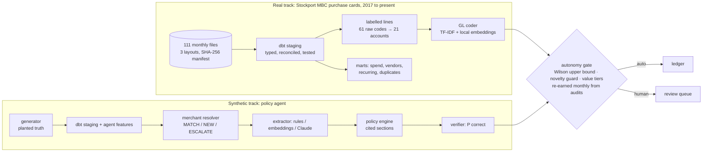

<!-- Generated from docs/README.template.md by `trustgate readme`. Edit the template, not this file. -->
# TrustGate

**AI agents earn autonomy only when the evidence says they can.**

When should an AI agent act without a human? TrustGate is an autonomy gate that unlocks an action only when the *upper 95% bound* of its audited error rate fits the budget. It's evaluated on **14,851 real corporate-card lines that council finance staff actually booked**, and on a policy-agent benchmark with planted ground truth.

[](https://github.com/VijayChamakuri/trustgate/actions/workflows/ci.yml)
[](https://vijaychamakuri.github.io/trustgate/)
[](https://vijaychamakuri.github.io/trustgate/dbt/)

[](https://github.com/astral-sh/ruff)
[](LICENSE)
[](docs/DATA_CARD.md)


## In plain English

Finance teams want AI agents to do routine work: code each card transaction to the right account, approve or flag expense reports. The hard question is **when it's safe to let the agent act without a person checking it**.

This project answers that with evidence instead of a gut-feel confidence setting:

- **How it decides:** the agent only gets to act alone on a kind of transaction once a random sample of its past work, checked by a person, shows its error rate is safely under a limit. That proof is re-checked every month, so autonomy can be lost as well as earned.
- **Real data:** tested on **14,851 real council credit-card transactions** that finance staff had coded by hand.
  - The agent ran month by month over the final 20 months (3,826 transactions).
  - Where the data was good enough (the council had also tagged each purchase with a category), it handled **41.3%** of transactions on its own at a **0.13%** error rate. It went over its 2% limit in **0 of 20** months.
  - Where the data wasn't good enough (only what the card itself shows), it **refused to act alone**. Letting it act anyway would have mis-booked **£242,402**.
- **Simulated expense reports:** checked across many simulated companies, it stayed inside its error limit every time (10/10). The common shortcut of trusting the average error rate did not.
- **The data layer:** built in dbt (a standard tool for tested, documented SQL data models), so the same clean definitions feed both the agent and the dashboards.

## Terms used below

| Term | Meaning |
|---|---|
| **GL account / GL coding** | The accounting category a transaction is booked to (e.g. "Travel", "Office supplies"). Choosing it is called coding. |
| **Autonomy / auto-post** | The agent acts without a person reviewing that item. Everything else goes to a human review queue. |
| **Error budget** | The highest error rate the business accepts for actions taken without review (2% for GL coding here). |
| **Audit** | A random sample of the agent's decisions that a person checks. This is the only evidence used to grant autonomy. |
| **Wilson upper bound** | A cautious estimate of the true error rate: "with 95% confidence, errors are at most X%". With few audits it stays high, so autonomy waits for evidence. |
| **Point estimate** | The plain average error rate from the audits. It looks fine on small samples and is the shortcut this project argues against. |
| **Novelty guard** | Anything the agent has never seen before (a new merchant, unfamiliar wording) always goes to a person. |
| **Value tiers** | Large transactions have to earn their own autonomy separately from small ones. |
| **Card-feed vs upstream setting** | Card-feed: only what a card platform sees (merchant name, team, amount). Upstream: also a category the council's staff had already assigned, which makes the job much easier. |
| **Leakage** | Money approved by the agent that policy says should have been stopped or reviewed. |
| **Seeds / sensitivity** | Re-running the simulation with different random worlds and different assumptions, to check the conclusion doesn't depend on luck or one guess. |

## Key results

**On real labels** (Stockport MBC purchase cards; 20 live months; 3,826 lines; 2% error budget):

- **Earns autonomy where the data supports it.** With the upstream procurement category, the gate auto-posts **41.3% of lines at 0.13% error** (95% upper bound 0.46%). It went over budget in **0 of 20 months**.
- **Refuses autonomy where the data doesn't.** On card-feed signals alone, the model is 66.6% accurate over the live months, and even its 95%-confidence predictions are wrong 5.3% of the time. The gate grants **nothing**.
  - Auto-posting everything would have mis-booked **£242,402** (33.4% error).
  - Point-estimate thresholds unlocked 4.2% at 8.2% error and broke the budget in 6 months.
  - The right product there is suggestions: the booked account is in the top 3 **86.4%** of the time.

**GL coding from card-feed signals** (rolling yearly evaluation, 11,756 test lines, 2017–2022):

- **62.4%** accuracy (95% CI 61.5%–63.3%), against 54.5% for a merchant → account lookup.
- **40.7%** on merchants never seen before, against 15.8% for the lookup.
- The ceiling set by staff booking identical inputs differently is **86.1%**.

**Policy-agent benchmark** (synthetic, planted ground truth):

- Earned autonomy stays inside its error budget in **10/10 seeds** and in **16/16** sensitivity settings.
- Point-estimate thresholds break the budget in 10/10 seeds and stay inside it in only 2/16 settings.
- Thresholds learned from reviewer history break it in 6/10 seeds.
- With too little evidence it correctly holds back: with 100 audits a month it grants no autonomy (0.0%), while 250 audits a month earn 48.1%.

> Everything above is regenerated from [`results/`](results) by `make reproduce`; the README itself is rendered from those files and CI fails if they drift apart.

## Why this matters

- **Autonomy is the product decision.** Finance agents that approve, reject or post spend need a principled answer to "act alone or ask?", not a confidence slider someone tuned once.
- **Reviewer clicks are a biased teacher.** Historical approvals are lenient. Thresholds learned from them look safe and aren't. This repo chooses thresholds from audited samples only, and shows the difference.
- **The data layer decides what agents can know.** Here duplicates, splits, limit breaches and receipt gaps are defined once in tested dbt models, and both agents and dashboards read them.

## Quickstart

```bash
git clone https://github.com/VijayChamakuri/trustgate && cd trustgate
uv sync
make real        # download real data (SHA-256 verified) -> dbt -> GL benchmark -> autonomy rollout
make synthetic   # policy-agent benchmark, default world, ~40 s
```

### Reproduce everything

```bash
make reproduce   # real track + 10 seeds + 48 sensitivity worlds + perception backends + site + README
```

| Step | What it does | Time (Apple M2, 8 GB, CPU only) |
|---|---|---|
| `make real` | 111 monthly files → warehouse → rolling GL benchmark → monthly rollout at 3 budgets × 2 settings | 19 min for the benchmark, plus the rollout |
| `make experiments` | 10 seeds, 16 sensitivity settings × 3 seeds, 2 perception backends | ~48 min |
| `make synthetic` | default world, report and charts | ~40 s |
| `make site` | static results dashboard and dbt docs | under a minute |

No paid APIs. The only model download is the free `BAAI/bge-small-en-v1.5` embedding model (ONNX, CPU, via fastembed). Raw data files are verified against [`data/stockport/manifest.json`](docs/DATA_CARD.md) checksums.

## How it works



| Module | Responsibility |
|---|---|
| [`sources/stockport.py`](src/trustgate/sources/stockport.py) | CKAN download, checksum manifest, three-layout parser (incl. an `.xlsx` published as `.csv`) |
| [`warehouse/models/stockport/`](warehouse/models/stockport) | staging, labelled population, contract-enforced fact, merchant dim, concentration/recurring/duplicate marts, semantic layer |
| [`realgl.py`](src/trustgate/realgl.py) | rolling temporal GL benchmark, label ceiling, monthly trustgate rollout |
| [`autonomy.py`](src/trustgate/autonomy.py) | Wilson interval, threshold selection, routing, rollout simulation |
| [`policy.py`](src/trustgate/policy.py) · [`extract.py`](src/trustgate/extract.py) | cited policy engine, verifier; rules / embedding / Claude extractors |
| [`experiments.py`](src/trustgate/experiments.py) | seeds, sensitivity sweeps, ablations, perception backends |

## Results in depth

### Real data: GL coding (card-feed signals only)

| Model (card-feed signals only) | Accuracy | 95% CI | Top-3 | Accuracy on new merchants | Macro-F1 |
|---|---:|---:|---:|---:|---:|
| Majority class | 17.0% | 16.3%–17.6% | – | 11.4% | 0.019 |
| Merchant → account lookup | 54.5% | 53.6%–55.4% | – | 15.8% | 0.313 |
| Local embeddings, kNN | 60.1% | 59.2%–61.0% | 78.4% | 37.3% | 0.339 |
| Char TF-IDF + logistic regression | 60.9% | 60.0%–61.8% | 80.7% | 34.6% | 0.354 |
| Local embeddings + logistic regression | 61.3% | 60.4%–62.2% | 82.5% | 38.9% | 0.366 |
| **TF-IDF + embeddings + logistic regression** | 62.4% | 61.5%–63.3% | 82.9% | 40.7% | 0.379 |

The labelled population is 14,851 lines, 21 accounts and 1,992 normalised merchants. With the council's own procurement category added (upstream setting), the same model reaches 91.4%, and a category lookup alone gets 90.8%. That field was assigned by staff alongside the label, which is why it isn't the headline ([ADR-5](docs/DESIGN_DECISIONS.md)). The upstream label ceiling is 99.1%.


### Real data: earned autonomy

| Policy (2% error budget) | Card feed: auto-posted | error | months over budget | Upstream: auto-posted | error | months over budget |
|---|---:|---:|---:|---:|---:|---:|
| Auto-post everything | 100.0% | 33.4% | 20/20 | 100.0% | 4.18% | 18/20 |
| Point-estimate threshold | 4.2% | 8.2% | 6/20 | 62.8% | 0.50% | 1/20 |
| Wilson upper bound | 0.0% | 0.0% | 0/20 | 14.9% | 0.18% | 0/20 |
| + novelty guard | 0.0% | 0.0% | 0/20 | 21.6% | 0.12% | 0/20 |
| **+ value tiers (earned autonomy)** | 0.0% | 0.0% | 0/20 | 41.3% | 0.13% | 0/20 |

Each month the gate sees only audits from earlier months (40 random lines a month), and the model is refit on all prior months every quarter. Results at 5% and 10% budgets are in [`results/real/autonomy.json`](results/real/autonomy.json).


### Synthetic policy-agent benchmark

| Autonomy policy (mean ± sd over 10 seeds) | Auto-actioned | Error on auto-actions | Seeds over the 1% budget | Policy leakage | Total cost |
|---|---:|---:|---:|---:|---:|
| Trust the rules engine everywhere | 88.7% ± 0.5% | 5.36% ± 0.37% | 10/10 | $24,270 ± $4,382 | $30,542 |
| Thresholds learned from reviewer history | 80.4% ± 1.6% | 0.97% ± 0.38% | 6/10 | $6,612 ± $3,529 | $10,475 |
| Audited gold, point-estimate threshold | 84.7% ± 0.7% | 1.44% ± 0.23% | 10/10 | $11,087 ± $2,772 | $14,197 |
| + Wilson upper bound | 75.1% ± 8.7% | 0.68% ± 0.31% | 2/10 | $4,055 ± $2,274 | $8,985 |
| + novelty guard | 71.8% ± 7.3% | 0.45% ± 0.14% | 0/10 | $3,955 ± $1,697 | $9,513 |
| **+ value tiers = earned autonomy** | 62.3% ± 11.1% | 0.45% ± 0.13% | 0/10 | $1,415 ± $693 | $8,866 |

**Ablations** (10 seeds):

| Ablation (drop one safeguard) | Auto-actioned | Error on auto-actions | Policy leakage |
|---|---:|---:|---:|
| Full policy | 62.3% | 0.45% | $1,415 |
| − Wilson bound (point estimate) | 77.3% | 0.69% | $4,516 |
| − novelty guard | 65.7% | 0.72% | $2,387 |
| − value tiers | 71.8% | 0.45% | $3,955 |

**Sensitivity:** does the conclusion survive changing the generator's assumptions?

| Assumption varied | Values | Earned autonomy within budget | Point estimate within budget |
|---|---|---:|---:|
| Reviewer leniency | 0.0, 0.03, 0.06, 0.1, 0.15 | 5/5 | 0/5 |
| Memo drift rate | 0.0, 0.15, 0.35, 0.5 | 4/4 | 1/4 |
| Audits per month | 100, 250, 500, 1000 | 4/4 | 0/4 |
| Error budget | 0.005, 0.01, 0.02 | 3/3 | 1/3 |

**Perception backends** (same world, rules engine, verifier and audits; only signal extraction changes):

| Perception backend | Alcohol recall | Premium-cabin recall | Personal-memo recall | Engine accuracy | Earned autonomy | Error |
|---|---:|---:|---:|---:|---:|---:|
| rules | 83.2% | 62.5% | 39.5% | 90.0% | 65.8% | 0.41% |
| rules+embed | 86.9% | 66.7% | 86.0% | 82.0% | 59.8% | 0.28% |

A 33M-parameter local embedding model recovers some open-vocabulary signals (e.g. "meant to use my own card", "Delta One"). It misses named cocktails like "Aperol Spritz" and airline sub-brands like "Mint", which is world knowledge. That is where an LLM extractor is expected to help. The Claude extractor is implemented and unit-tested, but wasn't benchmarked (no paid APIs).

The merchant resolver matched 8,406 descriptors at 100.00% MATCH precision and 96.7% registry recall, with **0** look-alike confusions (Amazon/AWS, Uber/Uber Eats, Apple/Applebee's). The verifier's live AUC is 0.982.

### Warehouse (real data, all years)

| Check | Result |
|---|---|
| Source files downloaded (SHA-256 manifest) | 111 (110 unique; 4.5 MB) |
| Statement months covered | 2017-01 to 2026-10 |
| Card lines in the warehouse | 33,377 (£4,217,508 after refunds; amounts are net of VAT to 2022-06 and gross after, as published) |
| Lines with a booked GL account (incl. refunds; scoring excludes them) | 15,355 |
| Placeholder labels excluded from scoring | 58 |
| Refund lines | 1,160 |
| Distinct raw merchant strings → normalised merchant keys | 7,288 → 3,431 |
| Publisher layouts reconciled | v1_net_10col (2017-01 to 2022-06, 14,737 lines), v2_net_8col (2020-02 to 2020-06, 676 lines), v3_gross_6col (2022-07 to 2026-10, 17,964 lines) |
| Settlement-before-purchase dates (dbt warning) | 1,960 lines |
| Possible duplicate charges (same merchant + amount within 3 days) | 871 (£173,972) |

Card spend has become more concentrated: the top 10 merchants took 44.7% of spend in 2017 and 63.5% in 2026 (through the latest published month; see `mart_stockport_vendor_concentration`). Full lineage and column docs are on the [dbt docs site](https://vijaychamakuri.github.io/trustgate/dbt/).

## Limitations

- **One public-sector organisation.** Stockport's coding conventions and chart of accounts aren't a commercial company's, and in the labelled years the card feed carries no MCC or receipts.
- **The policy-agent track is synthetic.** Every planted rate is an assumption, listed in the [data card](docs/DATA_CARD.md). Conclusions are stated only where they survive the sensitivity analysis.
- **No LLM numbers.** The free embedding backend is a stand-in, so perception results understate what an LLM extractor would do.
- **Random audits starve rare, high-value items.** Value-stratified auditing would let the high-value tier earn autonomy sooner.

## Roadmap

1. Value-stratified and uncertainty-targeted audit sampling, measured in labels saved per unit of autonomy.
2. Run the Claude extractor through the same harness (per-signal recall, cost per 1k lines).
3. Online drift detection (merchant-mix and memo-vocabulary PSI) to revoke autonomy before errors show up in audits.
4. A text-to-SQL analyst restricted to the semantic layer, evaluated against the same agent on raw tables.

## Project structure

```
src/trustgate/   sources/ (real data), realgl, autonomy, policy, extract, resolve, experiments, site, readme
warehouse/             dbt project: synthetic + stockport models, seeds, macros, tests, semantic layer
policy/                expense policy with stable section IDs (cited by the agent)
results/               every number in this README (JSON + charts)
docs/                  METHODOLOGY · DATA_CARD · DESIGN_DECISIONS · README template
site/                  GitHub Pages: results dashboard + dbt docs
```

## Citation and licence

Code is MIT-licensed ([LICENSE](LICENSE)); cite via [CITATION.cff](CITATION.cff). Real data: *Contains public sector information licensed under the Open Government Licence v3.0* (Stockport Metropolitan Borough Council).
