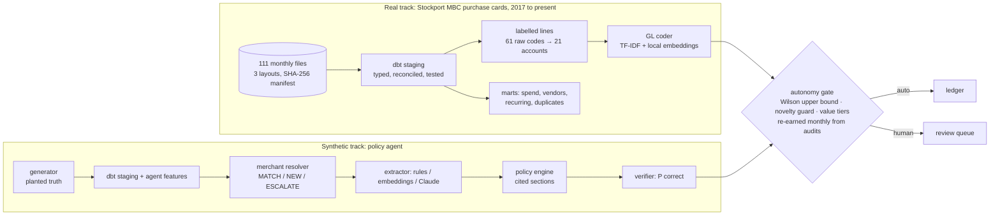

<!-- Generated from docs/README.template.md by `ea readme`. Edit the template, not this file. -->
# earned-autonomy

**When should a finance agent act without a human?** An autonomy gate for finance agents that unlocks an action only when the *upper 95% bound* of its audited error rate fits the budget. It's evaluated on **{{real_lines}} real corporate-card lines that council finance staff actually booked**, and on a policy-agent benchmark with planted ground truth.

[](https://github.com/VijayChamakuri/earned-autonomy/actions/workflows/ci.yml)
[](https://vijaychamakuri.github.io/earned-autonomy/)
[](https://vijaychamakuri.github.io/earned-autonomy/dbt/)

[](https://github.com/astral-sh/ruff)
[](LICENSE)
[](docs/DATA_CARD.md)


## Key results

**On real labels** (Stockport MBC purchase cards; {{live_months}} live months; {{live_lines}} lines; 2% error budget):

- **Earns autonomy where the data supports it.** With the upstream procurement category, the gate auto-posts **{{up_auto}} of lines at {{up_err}} error** (95% upper bound {{up_err_ci_hi}}). It went over budget in **{{up_over}} of {{live_months}} months**.
- **Refuses autonomy where the data doesn't.** On card-feed signals alone, the model is {{cf_model_acc}} accurate over the live months, and even its 95%-confidence predictions are wrong {{cf_err_at_95}} of the time. The gate grants **nothing**.
  - Auto-posting everything would have mis-booked **{{cf_misposted}}** ({{cf_all_err}} error).
  - Point-estimate thresholds unlocked {{cf_point_auto}} at {{cf_point_err}} error and broke the budget in {{cf_point_over}} months.
  - The right product there is suggestions: the booked account is in the top 3 **{{cf_top3}}** of the time.

**GL coding from card-feed signals** (rolling yearly evaluation, {{gl_eval_lines}} test lines, {{real_years}}):

- **{{best_acc}}** accuracy (95% CI {{best_ci}}), against {{lookup_acc}} for a merchant → account lookup.
- **{{best_new}}** on merchants never seen before, against {{lookup_new}} for the lookup.
- The ceiling set by staff booking identical inputs differently is **{{ceiling_card}}**.

**Policy-agent benchmark** (synthetic, planted ground truth):

- Earned autonomy stays inside its error budget in **{{syn_within_budget}} seeds** and in **{{sens_earned_ok}}/{{sens_total}}** sensitivity settings.
- Point-estimate thresholds break the budget in {{point_over}} seeds and stay inside it in only {{sens_point_ok}}/{{sens_total}} settings.
- Thresholds learned from reviewer history break it in {{hist_over}} seeds.
- With too little evidence it correctly holds back: {{aud_low_n}} audits a month unlock {{aud_low}}, while {{aud_mid_n}} unlock {{aud_mid}}.

> Everything above is regenerated from [`results/`](results) by `make reproduce`; the README itself is rendered from those files and CI fails if they drift apart.

## Why this matters

- **Autonomy is the product decision.** Finance agents that approve, reject or post spend need a principled answer to "act alone or ask?", not a confidence slider someone tuned once.
- **Reviewer clicks are a biased teacher.** Historical approvals are lenient. Thresholds learned from them look safe and aren't. This repo chooses thresholds from audited samples only, and shows the difference.
- **The data layer decides what agents can know.** Here duplicates, splits, limit breaches and receipt gaps are defined once in tested dbt models, and both agents and dashboards read them.

## Quickstart

```bash
git clone https://github.com/VijayChamakuri/earned-autonomy && cd earned-autonomy
uv sync
make real        # download real data (SHA-256 verified) -> dbt -> GL benchmark -> autonomy rollout
make synthetic   # policy-agent benchmark, default world, ~40 s
```

### Reproduce everything

```bash
make reproduce   # real track + 10 seeds + 48 sensitivity worlds + perception backends + site + README
```

| Step | What it does | Time (Apple M2, 8 GB, CPU only) |
|---|---|---|
| `make real` | 111 monthly files → warehouse → rolling GL benchmark → monthly rollout at 3 budgets × 2 settings | ~35 min |
| `make experiments` | 10 seeds, 16 sensitivity settings × 3 seeds, 2 perception backends | ~35 min |
| `make synthetic` | default world, report and charts | ~40 s |
| `make site` | static results dashboard and dbt docs | ~20 s |

No paid APIs. The only model download is the free `BAAI/bge-small-en-v1.5` embedding model (ONNX, CPU, via fastembed). Raw data files are verified against [`data/stockport/manifest.json`](docs/DATA_CARD.md) checksums.

## How it works



| Module | Responsibility |
|---|---|
| [`sources/stockport.py`](src/earned_autonomy/sources/stockport.py) | CKAN download, checksum manifest, three-layout parser (incl. an `.xlsx` published as `.csv`) |
| [`warehouse/models/stockport/`](warehouse/models/stockport) | staging, labelled population, contract-enforced fact, merchant dim, concentration/recurring/duplicate marts, semantic layer |
| [`realgl.py`](src/earned_autonomy/realgl.py) | rolling temporal GL benchmark, label ceiling, monthly earned-autonomy rollout |
| [`autonomy.py`](src/earned_autonomy/autonomy.py) | Wilson interval, threshold selection, routing, rollout simulation |
| [`policy.py`](src/earned_autonomy/policy.py) · [`extract.py`](src/earned_autonomy/extract.py) | cited policy engine, verifier; rules / embedding / Claude extractors |
| [`experiments.py`](src/earned_autonomy/experiments.py) | seeds, sensitivity sweeps, ablations, perception backends |

## Results in depth

### Real data: GL coding (card-feed signals only)

{{gl_table}}

The labelled population is {{real_lines}} lines, {{real_accounts}} accounts and {{real_merchants}} normalised merchants. With the council's own procurement category added (upstream setting), the same model reaches {{up_best_acc}}, and a category lookup alone gets {{up_cat_acc}}. That field was assigned by staff alongside the label, which is why it isn't the headline ([ADR-5](docs/DESIGN_DECISIONS.md)). The upstream label ceiling is {{ceiling_up}}.


### Real data: earned autonomy

{{autonomy_table}}

Each month the gate sees only audits from earlier months ({{audits}} random lines a month), and the model is refit on all prior months every quarter. Results at 5% and 10% budgets are in [`results/real/autonomy.json`](results/real/autonomy.json).


### Synthetic policy-agent benchmark

{{synthetic_table}}

**Ablations** (10 seeds):

{{ablation_table}}

**Sensitivity:** does the conclusion survive changing the generator's assumptions?

{{sensitivity_table}}

**Perception backends** (same world, rules engine, verifier and audits; only signal extraction changes):

{{extractor_table}}

A 33M-parameter local embedding model recovers some open-vocabulary signals (e.g. "meant to use my own card", "Delta One"). It misses named cocktails like "Aperol Spritz" and airline sub-brands like "Mint", which is world knowledge. That is where an LLM extractor is expected to help. The Claude extractor is implemented and unit-tested, but wasn't benchmarked (no paid APIs).

The merchant resolver matched {{res_desc}} descriptors at {{res_prec}} MATCH precision and {{res_recall}} registry recall, with **{{res_conf}}** look-alike confusions (Amazon/AWS, Uber/Uber Eats, Apple/Applebee's). The verifier's live AUC is {{verifier_auc}}.

### Warehouse (real data, all years)

{{warehouse_table}}

Top-10 merchant share of card spend went from {{top10_first}} in {{conc_first_year}} to {{top10_last}} in {{conc_last_year}} (`mart_stockport_vendor_concentration`). Full lineage and column docs are on the [dbt docs site](https://vijaychamakuri.github.io/earned-autonomy/dbt/).

## Limitations

- **One public-sector organisation.** Stockport's coding conventions and chart of accounts aren't a commercial company's, and in the labelled years the card feed carries no MCC or receipts.
- **The policy-agent track is synthetic.** Every planted rate is an assumption, listed in the [data card](docs/DATA_CARD.md). Conclusions are stated only where they survive the sensitivity analysis.
- **No LLM numbers.** The free embedding backend is a stand-in, so perception results understate what an LLM extractor would do.
- **Random audits starve rare, high-value items.** Value-stratified auditing would let the high-value tier earn autonomy sooner.

## Roadmap

1. Value-stratified and uncertainty-targeted audit sampling, measured in labels saved per unit of autonomy.
2. Run the Claude extractor through the same harness (per-signal recall, cost per 1k lines).
3. Online drift detection (merchant-mix and memo-vocabulary PSI) to revoke autonomy before errors show up in audits.
4. A text-to-SQL analyst restricted to the semantic layer, evaluated against the same agent on raw tables.

## Project structure

```
src/earned_autonomy/   sources/ (real data), realgl, autonomy, policy, extract, resolve, experiments, site, readme
warehouse/             dbt project: synthetic + stockport models, seeds, macros, tests, semantic layer
policy/                expense policy with stable section IDs (cited by the agent)
results/               every number in this README (JSON + charts)
docs/                  METHODOLOGY · DATA_CARD · DESIGN_DECISIONS · README template
site/                  GitHub Pages: results dashboard + dbt docs
```

## Citation and licence

Code is MIT-licensed ([LICENSE](LICENSE)); cite via [CITATION.cff](CITATION.cff). Real data: *Contains public sector information licensed under the Open Government Licence v3.0* (Stockport Metropolitan Borough Council).
