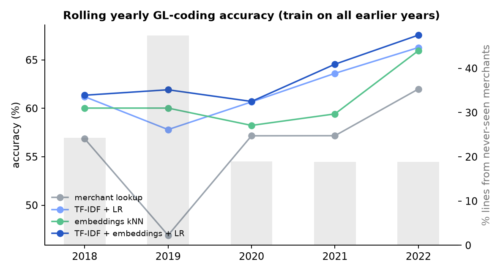
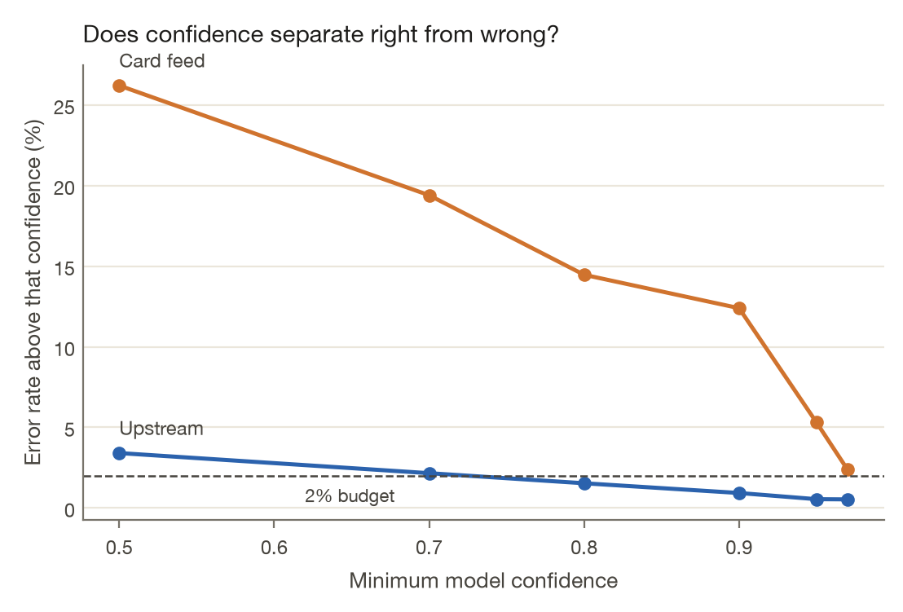

<!-- Generated from docs/RESULTS.template.md by `trustgate readme`. Edit the template, not this file. -->
# Results

Every number on this page is rendered from [`results/`](../results) by `trustgate readme`. The README keeps one headline table. Confidence intervals and the longer comparisons are here. Procedure and hyperparameters are in [METHODOLOGY.md](METHODOLOGY.md).

## Council ledger coding

The scoring set is 14,851 labelled lines, 21 accounts, and 1,992 normalised merchants, years 2017–2022. Each test year from 2018 through 2022 is scored by a model trained only on earlier years. The card-feed setting uses the merchant string, department, service, and amount. Pooled over 11,756 test lines, with a bootstrap 95% confidence interval (CI) over lines (2,000 resamples). In the table, TF-IDF is term frequency–inverse document frequency and kNN is k-nearest neighbours.

| Model (card-feed signals only) | Accuracy | 95% CI | Top-3 | Accuracy on new merchants | Macro-F1 |
|---|---:|---:|---:|---:|---:|
| Majority class | 17.0% | 16.3%–17.6% | – | 11.4% | 0.019 |
| Merchant → account lookup | 54.5% | 53.6%–55.4% | – | 15.8% | 0.313 |
| Local embeddings, kNN | 60.1% | 59.2%–61.0% | 78.4% | 37.3% | 0.339 |
| Char TF-IDF + logistic regression | 60.9% | 60.0%–61.8% | 80.7% | 34.6% | 0.354 |
| Local embeddings + logistic regression | 61.3% | 60.4%–62.2% | 82.5% | 38.9% | 0.366 |
| **TF-IDF + embeddings + logistic regression** | 62.4% | 61.5%–63.3% | 82.9% | 40.7% | 0.379 |

Staff disagreement on identical card-feed inputs caps a deterministic model at 86.1%. With the procurement category added, the same combined model reaches 91.4% and a lookup on that category alone reaches 90.8%. That field was assigned by staff with the label, which is why it is not the headline. The upstream ceiling is 99.1%.

On merchants absent from training, the combined card-feed model is 40.7%, against 15.8% for the lookup.

## Council rollout

Live months are the last 20 labelled months, 3,826 lines, after a shadow period. Each month, 40 random lines are audited, and thresholds use only earlier audits. The model refits on prior months every quarter. The table is the 2% error budget. The same rollout at 5% and 10% is in [`results/real/autonomy.json`](../results/real/autonomy.json).

| Policy (2% error budget) | Card feed: auto-posted | error | months over budget | Upstream: auto-posted | error | months over budget |
|---|---:|---:|---:|---:|---:|---:|
| Auto-post everything | 100.0% | 33.4% | 20/20 | 100.0% | 4.18% | 18/20 |
| Point-estimate threshold | 4.2% | 8.2% | 6/20 | 62.8% | 0.50% | 1/20 |
| Wilson upper bound | 0.0% | – | 0/20 | 14.9% | 0.18% | 0/20 |
| + novelty guard | 0.0% | – | 0/20 | 21.6% | 0.12% | 0/20 |
| **+ value tiers (earned autonomy)** | 0.0% | – | 0/20 | 41.3% | 0.13% | 0/20 |

A dash means the policy booked zero lines. The result file stores an error rate of 0 for that row, because `outcome` divides by `max(n, 1)`, and a Wilson interval of 0–100%, because `wilson_interval(0, 0)` returns that. It is not a measured error rate.

With the staff category, earned autonomy booked 1,579 lines, 2 of them wrong (0.13%, 95% upper bound 0.46%), and mis-booked £149.83. It went over the budget in 0 of 20 months. The card-feed model was 66.6% accurate on these live lines; with the category it was 95.8%. The rollout chart rounds those two live-month accuracies to 67% and 96%. They are not the rolling yearly scores in the table above.

Booking every card-feed line would have mis-booked £242,402 (33.4% error) and gone over the budget in all 20 months. The booked account is in the card-feed model's top 3 on 86.4% of live lines.

Error among lines at or above a confidence cut, card feed: 26.2% at 0.50, 5.3% at 0.95, 2.4% at 0.97. The last of those is still over 2%. With the category, the error is 1.5% once confidence is at least 0.80.

16.4% of live lines have a merchant key absent from the training window.

## Synthetic policy agent

There are no public labels for expense decisions, so the generator plants them. The comparison below is the mean and standard deviation over 10 seeds. "Seeds over the budget" counts seeds whose realized error on auto-actions was above the 1% budget. The gate itself decides from the Wilson upper bound; this column is the realized rate afterwards.

| Autonomy policy (mean ± sd over 10 seeds) | Auto-actioned | Error on auto-actions | Seeds over the 1% budget | Policy leakage | Total cost |
|---|---:|---:|---:|---:|---:|
| Trust the rules engine everywhere | 88.7% ± 0.5% | 5.36% ± 0.37% | 10/10 | $24,270 ± $4,382 | $30,542 |
| Thresholds learned from reviewer history | 80.4% ± 1.6% | 0.97% ± 0.38% | 6/10 | $6,612 ± $3,529 | $10,475 |
| Audited gold, point-estimate threshold | 84.7% ± 0.7% | 1.44% ± 0.23% | 10/10 | $11,087 ± $2,772 | $14,197 |
| + Wilson upper bound | 75.1% ± 8.7% | 0.68% ± 0.31% | 2/10 | $4,055 ± $2,274 | $8,985 |
| + novelty guard | 71.8% ± 7.3% | 0.45% ± 0.14% | 0/10 | $3,955 ± $1,697 | $9,513 |
| **+ value tiers = earned autonomy** | 62.3% ± 11.1% | 0.45% ± 0.13% | 0/10 | $1,415 ± $693 | $8,866 |

Dropping one safeguard, same 10 seeds. The leakage and cost columns are means. Standard deviations are in the table above.

| Ablation (drop one safeguard) | Auto-actioned | Error on auto-actions | Policy leakage |
|---|---:|---:|---:|
| Full policy | 62.3% | 0.45% | $1,415 |
| − Wilson bound (point estimate) | 77.3% | 0.69% | $4,516 |
| − novelty guard | 65.7% | 0.72% | $2,387 |
| − value tiers | 71.8% | 0.45% | $3,955 |

Sensitivity varies one generator assumption at a time, 3 seeds at each point. A point counts as inside the budget when the mean realized error is at or under 1%, or under the budget being varied when that is the assumption.

| Assumption varied | Values | Earned autonomy within budget | Point estimate within budget |
|---|---|---:|---:|
| Reviewer leniency | 0.0, 0.03, 0.06, 0.1, 0.15 | 5/5 | 0/5 |
| Memo drift rate | 0.0, 0.15, 0.35, 0.5 | 4/4 | 1/4 |
| Audits per month | 100, 250, 500, 1000 | 4/4 | 0/4 |
| Error budget | 0.005, 0.01, 0.02 | 3/3 | 1/3 |

Earned autonomy was inside the budget at 16 of 16 points. The point-estimate threshold was inside at 2 of 16. With 100 audits a month the earned-autonomy policy booked 0.0%. With 250 it booked 48.1%.

Charts for the default world, not the 10-seed mean: [rollout by month](../results/rollout_by_month.png), [automation against error](../results/tradeoff_curve.png), [verifier calibration](../results/calibration.png). The written default-world report is [results/REPORT.md](../results/REPORT.md).

## Perception, resolver, verifier

One paired run, not a mean over seeds. Personal-memo recall is 39.5% for the rules extractor and 86.0% with the local embedding added. The rules list misses phrasings the unit test names, including a Negroni and a cabin written "Delta One". The embedding model is `BAAI/bge-small-en-v1.5`, which [`embeddings.py`](../src/trustgate/embeddings.py) describes as 33 million parameters and 384 dimensions. The Claude extractor is not in this table.

| Perception backend | Alcohol recall | Premium-cabin recall | Personal-memo recall | Engine accuracy | Earned autonomy | Error |
|---|---:|---:|---:|---:|---:|---:|
| rules | 83.2% | 62.5% | 39.5% | 90.0% | 65.8% | 0.41% |
| rules+embed | 86.9% | 66.7% | 86.0% | 82.0% | 59.8% | 0.28% |

Merchant resolution, verifier, and the default-world report are the single run in [`results/metrics.json`](../results/metrics.json): 14,964 transactions, 4,828 of them in the live months, rules extractor. The command-line default seed is 7. The resolver saw 8,406 descriptors, with match precision 100.00% and registry recall 96.7%, and 0 confusions on the protected look-alike pairs. The verifier's live receiver-operating-characteristic area under the curve (ROC AUC) is 0.982.

## Warehouse

VAT in the amount note is value-added tax. SHA-256 is the 256-bit secure hash on each downloaded file. GL is the general ledger. dbt is the data build tool. Counts below are the full publish, including months with no booked account. Scoring uses the labelled subset above.

| Check | Result |
|---|---|
| Source files downloaded (SHA-256 manifest) | 111 (110 unique; 4.5 MB) |
| Statement months covered | 2017-01 to 2026-10 |
| Card lines in the warehouse | 33,377 (£4,217,508 after refunds; amounts are net of VAT to 2022-06 and gross after, as published) |
| Lines with a booked GL account (incl. refunds; scoring excludes them) | 15,355 |
| Placeholder labels excluded from scoring | 58 |
| Refund lines | 1,160 |
| Distinct raw merchant strings → normalised merchant keys | 7,288 → 3,431 |
| Publisher layouts reconciled | v1_net_10col (2017-01 to 2022-06, 14,737 lines), v2_net_8col (2020-02 to 2020-06, 676 lines), v3_gross_6col (2022-07 to 2026-10, 17,964 lines) |
| Settlement-before-purchase dates (dbt warning) | 1,960 lines |
| Possible duplicate charges (same merchant + amount within 3 days) | 871 (£173,972) |

The top 10 merchants took 44.7% of spend in 2017 and 63.5% in 2026 (through the latest published month).

## Recorded durations

`results/real/gl_benchmark.json` records 1,117 seconds for the GL benchmark, including model fitting. `results/experiments.json` records 2,865.5 seconds for the 10 seeds, the sensitivity sweep, and the perception backends.
