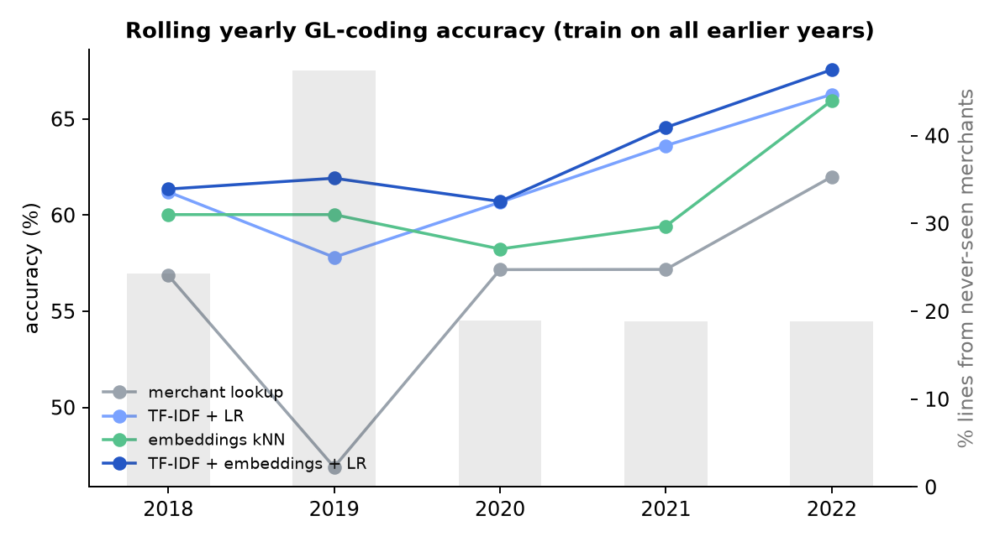
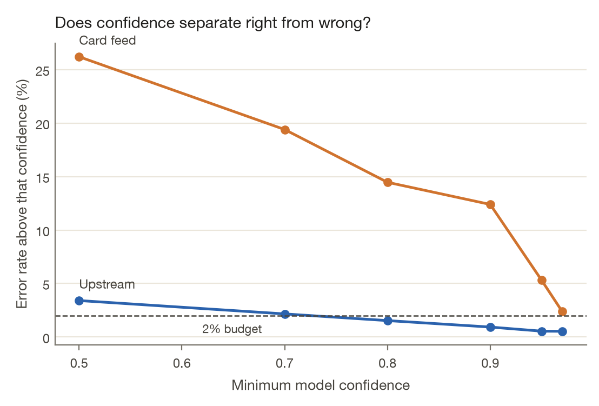

<!-- Generated from docs/RESULTS.template.md by `trustgate readme`. Edit the template, not this file. -->
# Results

Every number on this page is rendered from [`results/`](../results) by `trustgate readme`. The README keeps one headline table. Confidence intervals and the longer comparisons are here. Procedure and hyperparameters are in [METHODOLOGY.md](METHODOLOGY.md).

## Council ledger coding

The scoring set is {{real_lines}} labelled lines, {{real_accounts}} accounts, and {{real_merchants}} normalised merchants, years {{real_years}}. Each test year from 2018 through 2022 is scored by a model trained only on earlier years. The card-feed setting uses the merchant string, department, service, and amount. Pooled over {{gl_eval_lines}} test lines, with a bootstrap 95% confidence interval (CI) over lines (2,000 resamples). In the table, TF-IDF is term frequency–inverse document frequency and kNN is k-nearest neighbours.

{{gl_table}}

Staff disagreement on identical card-feed inputs caps a deterministic model at {{ceiling_card}}. With the procurement category added, the same combined model reaches {{up_best_acc}} and a lookup on that category alone reaches {{up_cat_acc}}. That field was assigned by staff with the label, which is why it is not the headline. The upstream ceiling is {{ceiling_up}}.

On merchants absent from training, the combined card-feed model is {{best_new}}, against {{lookup_new}} for the lookup.

## Council rollout

Live months are the last {{live_months}} labelled months, {{live_lines}} lines, after a shadow period. Each month, {{audits}} random lines are audited, and thresholds use only earlier audits. The model refits on prior months every quarter. The table is the 2% error budget. The same rollout at 5% and 10% is in [`results/real/autonomy.json`](../results/real/autonomy.json).

{{autonomy_table}}

A dash means the policy booked zero lines. The result file stores an error rate of 0 for that row, because `outcome` divides by `max(n, 1)`, and a Wilson interval of 0–100%, because `wilson_interval(0, 0)` returns that. It is not a measured error rate.

With the staff category, earned autonomy booked {{up_auto_n}} lines, {{up_auto_errors}} of them wrong ({{up_err}}, 95% upper bound {{up_err_ci_hi}}), and mis-booked {{up_misposted}}. It went over the budget in {{up_over}} of {{live_months}} months. The card-feed model was {{cf_model_acc}} accurate on these live lines; with the category it was {{up_model_acc}}. The rollout chart rounds those two live-month accuracies to {{cf_live_round}} and {{up_live_round}}. They are not the rolling yearly scores in the table above.

Booking every card-feed line would have mis-booked {{cf_misposted}} ({{cf_all_err}} error) and gone over the budget in all {{live_months}} months. The booked account is in the card-feed model's top 3 on {{cf_top3}} of live lines.

Error among lines at or above a confidence cut, card feed: {{cf_err_at_50}} at 0.50, {{cf_err_at_95}} at 0.95, {{cf_err_at_97}} at 0.97. The last of those is still over 2%. With the category, the error is {{up_err_at_80}} once confidence is at least 0.80.

{{novel_share}} of live lines have a merchant key absent from the training window.

## Synthetic policy agent

There are no public labels for expense decisions, so the generator plants them. The comparison below is the mean and standard deviation over 10 seeds. "Seeds over the budget" counts seeds whose realized error on auto-actions was above the 1% budget. The gate itself decides from the Wilson upper bound; this column is the realized rate afterwards.

{{synthetic_table}}

Dropping one safeguard, same 10 seeds. The leakage and cost columns are means. Standard deviations are in the table above.

{{ablation_table}}

Sensitivity varies one generator assumption at a time, 3 seeds at each point. A point counts as inside the budget when the mean realized error is at or under 1%, or under the budget being varied when that is the assumption.

{{sensitivity_table}}

Earned autonomy was inside the budget at {{sens_earned_ok}} of {{sens_total}} points. The point-estimate threshold was inside at {{sens_point_ok}} of {{sens_total}}. With {{aud_low_n}} audits a month the earned-autonomy policy booked {{aud_low}}. With {{aud_mid_n}} it booked {{aud_mid}}.

Charts for the default world, not the 10-seed mean: [rollout by month](../results/rollout_by_month.png), [automation against error](../results/tradeoff_curve.png), [verifier calibration](../results/calibration.png). The written default-world report is [results/REPORT.md](../results/REPORT.md).

## Perception, resolver, verifier

One paired run, not a mean over seeds. Personal-memo recall is {{rules_personal}} for the rules extractor and {{embed_personal}} with the local embedding added. The rules list misses phrasings the unit test names, including a Negroni and a cabin written "Delta One". The embedding model is `BAAI/bge-small-en-v1.5`, which [`embeddings.py`](../src/trustgate/embeddings.py) describes as 33 million parameters and 384 dimensions. The Claude extractor is not in this table.

{{extractor_table}}

Merchant resolution, verifier, and the default-world report are the single run in [`results/metrics.json`](../results/metrics.json): {{syn_txns}} transactions, {{syn_live}} of them in the live months, rules extractor. The command-line default seed is 7. The resolver saw {{res_desc}} descriptors, with match precision {{res_prec}} and registry recall {{res_recall}}, and {{res_conf}} confusions on the protected look-alike pairs. The verifier's live receiver-operating-characteristic area under the curve (ROC AUC) is {{verifier_auc}}.

## Warehouse

VAT in the amount note is value-added tax. SHA-256 is the 256-bit secure hash on each downloaded file. GL is the general ledger. dbt is the data build tool. Counts below are the full publish, including months with no booked account. Scoring uses the labelled subset above.

{{warehouse_table}}

The top 10 merchants took {{top10_first}} of spend in {{conc_first_year}} and {{top10_last}} in {{conc_last_year}} (through the latest published month).

## Recorded durations

`results/real/gl_benchmark.json` records {{bench_seconds}} seconds for the GL benchmark, including model fitting. `results/experiments.json` records {{exp_seconds}} seconds for the 10 seeds, the sensitivity sweep, and the perception backends.
