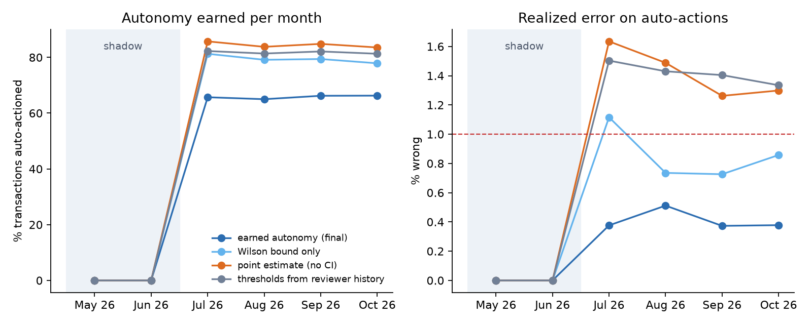
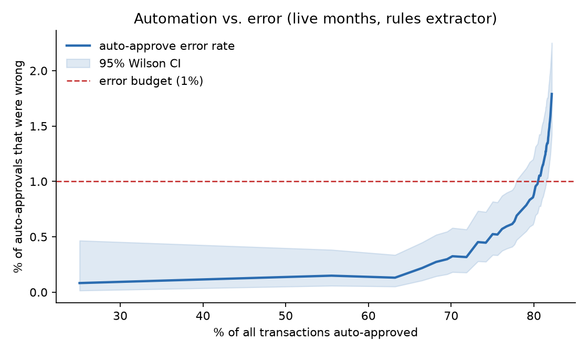
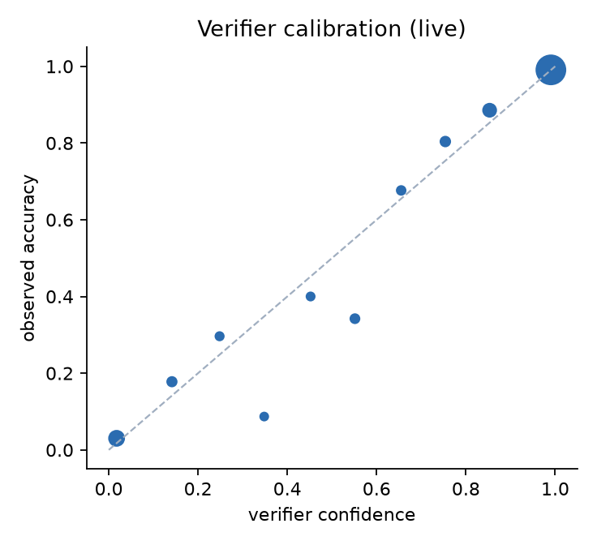

# Results

_Generated by `ea all`. 14,964 transactions; live evaluation on 4,828 transactions in the final four months. Extractor: `rules`._

## 1. How much autonomy did the policy agent earn?

Live months only. Every row is scored against audited gold labels.

| Policy | Auto-actioned | Wrong auto-actions | Error rate (95% CI) | Policy leakage | Human queue | Total cost |
|---|---:|---:|---|---:|---:|---:|
| Human reviews everything | 0.0% | 0 | 0.00% (0.00%–100.00%) | $0 | 4,828 | $19,312 |
| Trust the rules engine everywhere | 88.8% | 249 | 5.81% (5.15%–6.55%) | $21,760 | 540 | $28,450 |
| Thresholds set from reviewer history | 81.8% | 56 | 1.42% (1.09%–1.84%) | $11,957 | 880 | $15,477 |
| Thresholds from audited gold, point estimate | 84.5% | 58 | 1.42% (1.10%–1.83%) | $10,918 | 749 | $13,944 |
| + Wilson upper bound (audited gold) | 79.4% | 33 | 0.86% (0.61%–1.21%) | $5,512 | 993 | $9,484 |
| + novelty guard | 75.1% | 18 | 0.50% (0.31%–0.78%) | $6,516 | 1,204 | $11,332 |
| **+ value tiers = earned autonomy** | 65.8% | 13 | 0.41% (0.24%–0.70%) | $1,205 | 1,651 | $7,809 |

Cost model: 4 reviewer-minutes at $60/h per human review, leaked dollars at face value (half for review-worthy items), $30 per wrongful auto-reject.

| Month | Phase | Audited labels | Auto-approve τ (<$500) | Auto-approve τ (≥$500) | Auto-reject τ | Held by novelty guard | Auto-actioned | Error rate |
|---|---|---:|---:|---:|---:|---:|---:|---:|
| May 26 | shadow | 0 | locked | locked | locked | 1 | 0.0% | 0.00% |
| Jun 26 | shadow | 499 | locked | locked | locked | 2 | 0.0% | 0.00% |
| Jul 26 | live | 998 | 0.640 | locked | locked | 100 | 65.7% | 0.38% |
| Aug 26 | live | 1,456 | 0.510 | locked | locked | 105 | 65.0% | 0.51% |
| Sep 26 | live | 1,919 | 0.510 | locked | locked | 127 | 66.2% | 0.37% |
| Oct 26 | live | 2,372 | 0.510 | locked | locked | 110 | 66.3% | 0.38% |

## 2. Policy engine and verifier

- Rules engine decision accuracy (live): **90.0%**
- Verifier AUC for "is this decision right?": **0.982** live (shadow 0.994); Brier 0.0225

| Policy section | Violations (live) | Recall | Citation precision |
|---|---:|---:|---:|
| §2.1 | 238 | 56.7% | 48.6% |
| §2.2 | 67 | 80.6% | 26.3% |
| §3.1 | 24 | 62.5% | 100.0% |
| §3.2 | 34 | 76.5% | 68.4% |
| §4.1 | 12 | 100.0% | 100.0% |
| §5.1 | 26 | 100.0% | 100.0% |
| §5.2 | 37 | 45.9% | 100.0% |
| §6.1 | 36 | 100.0% | 46.8% |
| §6.2 | 50 | 100.0% | 64.9% |
| §7.1 | 44 | 100.0% | 100.0% |
| §7.2 | 17 | 100.0% | 85.0% |
| §8.1 | 27 | 100.0% | 17.5% |
| §9.1 | 17 | 100.0% | 100.0% |

## 3. Where perception fails (rules extractor)

| Signal | Precision | Recall | Support |
|---|---:|---:|---:|
| alcohol_on_meals | 100.0% | 83.2% | 351 |
| premium_cabin | 100.0% | 62.5% | 24 |
| personal_memo | 100.0% | 39.5% | 43 |

Meal type accuracy 71.9%; attendee count parsed 65.4%; nightly rate parsed 74.4%.

**Engine misses (said APPROVE, policy violated), by first violated section:**

| Section | Count | Median verifier confidence | Example |
|---|---:|---:|---|
| §2.1 | 61 | 0.53 | `wayne foods buying committee dinner, 3` |
| §5.2 | 13 | 0.93 | `meant to use my own card` |
| §3.1 | 9 | 0.76 | `flight to chicago` |
| §3.2 | 8 | 0.93 | `lodging - seattle trip` |
| §2.2 | 7 | 0.99 | `meal while traveling` |

**Largest wrong auto-actions under earned autonomy:**

| Descriptor | Amount | Memo | Agent | Gold |
|---|---:|---|---|---|
| `HYATT HOTELS` | $456.66 | lodging - seattle trip | APPROVE (0.853) | NEEDS_REVIEW §3.2 |
| `AIRBNB 1BSKQL5V` | $444.53 | hotel boston | APPROVE (0.961) | NEEDS_REVIEW §3.2 |
| `TST* BLUEBIRD CAFE CHICAG` | $362.52 | drinks + dinner globex 4pax | APPROVE (0.532) | NEEDS_REVIEW §2.1 |
| `CLV*RED LANTERN NEW YORK` | $348.00 | drinks + dinner massive dynamic 4pax | APPROVE (0.518) | NEEDS_REVIEW §2.1 |
| `CLV*SAFFRON KITCHEN NEW Y` | $212.36 | massive dynamic dinner | APPROVE (0.800) | NEEDS_REVIEW §2.1 |
| `PY *CAFE MIRABELLE SAN FR` | $74.60 | team lunch (5) | APPROVE (0.991) | REJECT §2.2 |
| `UBER *TRIP` | $71.03 | wrong card, sorry | APPROVE (0.954) | REJECT §5.2 |
| `PY *NONNAS KITCHEN LOS ANGELES` | $37.49 | meal while traveling | APPROVE (0.998) | REJECT §2.2 |

## 4. GL coding

- Merchant→GL lookup table: **81.5%** live accuracy
- Calibrated model: **97.6%** live (shadow 99.8%; the gap is memo-phrasing drift)
- Earned auto-posting without the novelty guard: 98.5% auto-posted at **1.87%** error (budget 1%, broken by drift)
- With the novelty guard: **90.7%** auto-posted at **0.21%** error

| Month | Threshold | Auto-posted | Error on auto-posted | Model accuracy on all |
|---|---:|---:|---:|---:|
| Jul 26 | 0.500 | 91.4% | 0.27% | 97.7% |
| Aug 26 | 0.500 | 91.2% | 0.18% | 97.5% |
| Sep 26 | 0.500 | 89.5% | 0.09% | 97.8% |
| Oct 26 | 0.500 | 90.7% | 0.28% | 97.6% |

## 5. Merchant resolution

- 8,406 distinct descriptors; MATCH precision **100.00%**, wrong-merge rate 0.00%, registry recall 96.7%
- New-vendor recall 82.2%; escalated to a human 1.7%; look-alike guardrail blocks 136; protected-pair confusions **0**

## 6. What the governed marts surface

- **Price creep:** 9 subscriptions up more than 5% since they started (largest: Snowflake +32%, Loom +28%, Notion +22%).
- **Orphaned subscriptions:** 3 still billing after the owner left, $10,900 since departure.
- **Duplicate tools:** 6 tools paid for by more than one cardholder (Anthropic, Loom, Miro, Notion, OpenAI, Zoom).

Review queue, live months:

| Decision | Items | Dollars |
|---|---:|---:|
| APPROVE | 836 | $579,452 |
| NEEDS_REVIEW | 546 | $209,658 |
| REJECT | 292 | $135,045 |
